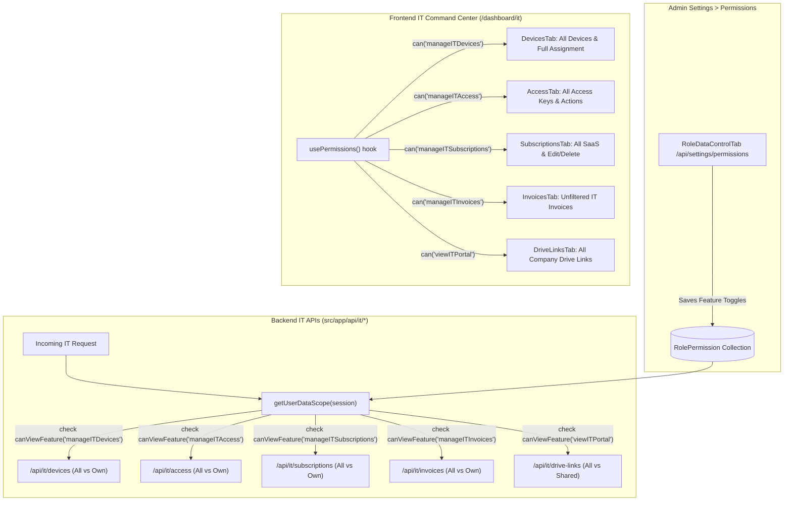

# Implementation Plan: Dynamic IT Portal Permissions (RBAC Controlled)

## 1. Overview & Objective
Enable dynamic, role-based visibility and management across all IT Portal tabs (Devices, Access Keys, Subscriptions, Drive Links, and Invoices). 

Currently, IT portal data visibility is hardcoded to `["Admin", "OPS", "Sub Admin"]` in backend APIs and `isAdmin || isOPS` in the frontend UI. This prevents HR (and any other role configured with IT permissions in **Settings > Permissions**) from viewing or managing other users' data.

### Key Goals:
1. **100% Dynamic Permissions**: All visibility and action permissions will be governed dynamically by the database-backed RBAC system via [`getUserDataScope(session)`](file:///d:/Dev%20AI/CRM/NexAce%20CRM/src/lib/dataScope.ts) on the backend and [`usePermissions().can(...)`](file:///d:/Dev%20AI/CRM/NexAce%20CRM/src/hooks/usePermissions.ts) on the frontend.
2. **Instant Revocability**: When an administrator toggles OFF any IT permission (`manageITDevices`, `manageITAccess`, `manageITSubscriptions`, `manageITInvoices`, or `viewITPortal`) for HR or any role in **Settings > Permissions**, the access is immediately revoked without needing any code changes.
3. **Granular Per-Tab Control**:
   - `manageITDevices`: View all company hardware, assign devices to any team member, register/edit/repair assets.
   - `manageITAccess`: View all team software access keys, grant/revoke access, edit licenses.
   - `manageITSubscriptions`: View all company SaaS subscriptions, plan costs, renewals, and sync subscription invoices.
   - `manageITInvoices`: View all company IT vendor & employee IT invoices across the organization.
   - `viewITPortal`: General read access to the command center overview and drive links.
4. **Strict Rule Compliance**: Zero desktop-only UI changes, strict FontAwesome 6 icons (`<i className="fa-solid fa-..." />`), touch targets $\ge 38\text{px}$, and clean TypeScript type checking.

---

## 2. Architecture & Data Flow



---

## 3. Detailed Step-by-Step Implementation Roadmap

### Phase 1: Backend API Dynamic Permission Checks

Instead of hardcoded `["Admin", "OPS", "Sub Admin"].includes(session.role)`, each endpoint will evaluate the specific permission via `getUserDataScope(session)`:

1. **Devices API**:
   - Files:
     - [`src/app/api/it/devices/route.ts`](file:///d:/Dev%20AI/CRM/NexAce%20CRM/src/app/api/it/devices/route.ts)
     - [`src/app/api/it/devices/[id]/route.ts`](file:///d:/Dev%20AI/CRM/NexAce%20CRM/src/app/api/it/devices/%5Bid%5D/route.ts)
   - Logic:
     ```typescript
     const dataScope = await getUserDataScope(session);
     const canManage = dataScope.role === "Admin" || dataScope.role === "OPS" || isSubAdminRole(dataScope.role) || dataScope.canViewFeature("manageITDevices");
     
     // In GET: If canManage, return all devices across all employees.
     // If false, filter to only devices where assignedTo === session.userName.
     
     // In POST/PUT/DELETE: If !canManage, return 403 Forbidden.
     ```

2. **Access Keys API**:
   - Files:
     - [`src/app/api/it/access/route.ts`](file:///d:/Dev%20AI/CRM/NexAce%20CRM/src/app/api/it/access/route.ts)
     - [`src/app/api/it/access/[id]/route.ts`](file:///d:/Dev%20AI/CRM/NexAce%20CRM/src/app/api/it/access/%5Bid%5D/route.ts)
   - Logic:
     ```typescript
     const dataScope = await getUserDataScope(session);
     const canManage = dataScope.role === "Admin" || dataScope.role === "OPS" || isSubAdminRole(dataScope.role) || dataScope.canViewFeature("manageITAccess");
     
     // In GET: If canManage, return all access entries. If false, return only assigned entries.
     // In POST/PUT/DELETE: If !canManage, return 403 Forbidden.
     ```

3. **Subscriptions API**:
   - Files:
     - [`src/app/api/it/subscriptions/route.ts`](file:///d:/Dev%20AI/CRM/NexAce%20CRM/src/app/api/it/subscriptions/route.ts)
     - [`src/app/api/it/subscriptions/[id]/route.ts`](file:///d:/Dev%20AI/CRM/NexAce%20CRM/src/app/api/it/subscriptions/%5Bid%5D/route.ts)
   - Logic:
     ```typescript
     const dataScope = await getUserDataScope(session);
     const canManage = dataScope.role === "Admin" || dataScope.role === "OPS" || isSubAdminRole(dataScope.role) || dataScope.canViewFeature("manageITSubscriptions");
     
     // In GET: If canManage, return all company subscriptions. If false, filter to owned/created.
     // In POST/PUT/DELETE: If !canManage, return 403 Forbidden.
     ```

4. **Drive Links API**:
   - Files:
     - [`src/app/api/it/drive-links/route.ts`](file:///d:/Dev%20AI/CRM/NexAce%20CRM/src/app/api/it/drive-links/route.ts)
     - [`src/app/api/it/drive-links/[id]/route.ts`](file:///d:/Dev%20AI/CRM/NexAce%20CRM/src/app/api/it/drive-links/%5Bid%5D/route.ts)
   - Logic:
     ```typescript
     const dataScope = await getUserDataScope(session);
     const canManage = dataScope.role === "Admin" || dataScope.role === "OPS" || isSubAdminRole(dataScope.role) || dataScope.canViewFeature("viewITPortal") || dataScope.canViewFeature("manageITAccess");
     
     // In GET: If canManage, return all team drive links. If false, filter to owned or explicitly shared.
     ```

5. **Invoices API**:
   - Files:
     - [`src/app/api/it/invoices/route.ts`](file:///d:/Dev%20AI/CRM/NexAce%20CRM/src/app/api/it/invoices/route.ts)
     - [`src/app/api/it/invoices/[id]/route.ts`](file:///d:/Dev%20AI/CRM/NexAce%20CRM/src/app/api/it/invoices/%5Bid%5D/route.ts)
   - Logic:
     ```typescript
     const dataScope = await getUserDataScope(session);
     const canManage = dataScope.role === "Admin" || dataScope.role === "OPS" || isSubAdminRole(dataScope.role) || dataScope.canViewFeature("manageITInvoices");
     
     // In GET: If canManage, return all IT invoices without restricting to personal email/name.
     ```

---

### Phase 2: Frontend IT Portal Dynamic RBAC Integration

Update [`src/app/dashboard/it/page.tsx`](file:///d:/Dev%20AI/CRM/NexAce%20CRM/src/app/dashboard/it/page.tsx):

1. **Replace Hardcoded `isPrivileged = isAdmin || isOPS`**:
   ```typescript
   const { can, isAdmin, isOPS } = usePermissions();

   // Granular dynamic permissions
   const canManageDevices = isAdmin || isOPS || can("manageITDevices");
   const canManageAccess = isAdmin || isOPS || can("manageITAccess");
   const canManageSubscriptions = isAdmin || isOPS || can("manageITSubscriptions");
   const canManageInvoices = isAdmin || isOPS || can("manageITInvoices");
   const canManageDrive = isAdmin || isOPS || can("viewITPortal") || can("manageITAccess");

   const isAnyITManager =
     canManageDevices ||
     canManageAccess ||
     canManageSubscriptions ||
     canManageInvoices ||
     canManageDrive;
   ```

2. **Per-Tab Props & Filtering**:
   - **`DevicesTab`**: Pass `isPrivileged={canManageDevices}`.
     - Unlocks the `lockedAssignedTo` field so HR/manager can assign devices to any employee.
     - Shows edit, repair, and retire action buttons.
   - **`InvoicesTab`**: Pass `isPrivileged={canManageInvoices}`.
     - Removes the personal email/name filter (lines 3720–3728) so all team and vendor IT invoices are visible.
     - Displays full invoice KPI counts in the summary badges.
   - **`AccessTab`**: Pass `isPrivileged={canManageAccess}`.
     - Displays all access entries, grant access button, and credentials editor.
   - **`SubscriptionsTab`**: Pass `isPrivileged={canManageSubscriptions}`.
     - Displays full organization SaaS inventory, costs, and plan renewal controls.
   - **`DriveLinksTab`**: Pass `isPrivileged={canManageDrive}`.
     - Displays full organization drive links and management controls.

3. **Overview Dashboard & KPI Stats**:
   - Update header KPI counts (total devices, active subscriptions, total invoices) to use the full data arrays when `isAnyITManager` is true.

---

### Phase 3: Verification & Reversibility Test

1. **Verify When Permissions are Enabled**:
   - Log in as HR (with IT permissions enabled in Settings).
   - Verify IT Command Center displays all devices across all employees.
   - Verify HR can assign devices to other employees.
   - Verify HR sees all access credentials, subscriptions, and invoices.
2. **Verify Instant Revocation When Disabled**:
   - In **Settings > Permissions**, toggle OFF `manageITDevices` for HR.
   - Refresh the IT Portal as HR.
   - Verify that Devices immediately restricts to only HR's personal device, and assigning to others is disabled.
   - Verify that the backend API returns 403 if an unauthorized device update is attempted.
3. **TypeScript & Build Verification**:
   - Run `npx tsc --noEmit` to ensure 0 compilation errors across all modified API routes and components.

---

## 4. File Modification Summary

| File | Change |
| :--- | :--- |
| [`src/app/api/it/devices/route.ts`](file:///d:/Dev%20AI/CRM/NexAce%20CRM/src/app/api/it/devices/route.ts) | Dynamic `canViewFeature("manageITDevices")` check for list & create |
| [`src/app/api/it/devices/[id]/route.ts`](file:///d:/Dev%20AI/CRM/NexAce%20CRM/src/app/api/it/devices/%5Bid%5D/route.ts) | Dynamic `canViewFeature("manageITDevices")` for edit & delete |
| [`src/app/api/it/access/route.ts`](file:///d:/Dev%20AI/CRM/NexAce%20CRM/src/app/api/it/access/route.ts) | Dynamic `canViewFeature("manageITAccess")` for list & grant access |
| [`src/app/api/it/access/[id]/route.ts`](file:///d:/Dev%20AI/CRM/NexAce%20CRM/src/app/api/it/access/%5Bid%5D/route.ts) | Dynamic `canViewFeature("manageITAccess")` for edit & revoke |
| [`src/app/api/it/subscriptions/route.ts`](file:///d:/Dev%20AI/CRM/NexAce%20CRM/src/app/api/it/subscriptions/route.ts) | Dynamic `canViewFeature("manageITSubscriptions")` for list & create |
| [`src/app/api/it/subscriptions/[id]/route.ts`](file:///d:/Dev%20AI/CRM/NexAce%20CRM/src/app/api/it/subscriptions/%5Bid%5D/route.ts) | Dynamic `canViewFeature("manageITSubscriptions")` for edit & delete |
| [`src/app/api/it/drive-links/route.ts`](file:///d:/Dev%20AI/CRM/NexAce%20CRM/src/app/api/it/drive-links/route.ts) | Dynamic `canViewFeature("viewITPortal")` / `manageITAccess` check |
| [`src/app/api/it/drive-links/[id]/route.ts`](file:///d:/Dev%20AI/CRM/NexAce%20CRM/src/app/api/it/drive-links/%5Bid%5D/route.ts) | Dynamic `canViewFeature("viewITPortal")` / `manageITAccess` for edit/delete |
| [`src/app/api/it/invoices/route.ts`](file:///d:/Dev%20AI/CRM/NexAce%20CRM/src/app/api/it/invoices/route.ts) | Dynamic `canViewFeature("manageITInvoices")` for company-wide list |
| [`src/app/dashboard/it/page.tsx`](file:///d:/Dev%20AI/CRM/NexAce%20CRM/src/app/dashboard/it/page.tsx) | Granular `can(...)` permission checks per tab instead of hardcoded `isAdmin || isOPS` |
