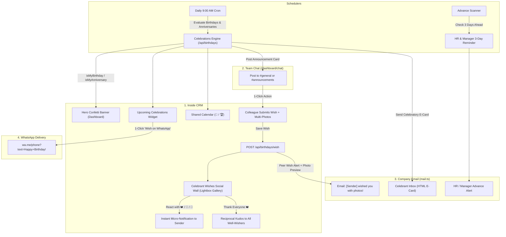

# Implementation Plan: Employee Birthday & Work Anniversary Celebration Engine (Multi-Channel Delivery)

## 1. Executive Summary & Core Objectives
The **Employee Celebrations Engine** fosters a connected, vibrant workplace culture across NexAce CRM by celebrating both **Birthdays** (`dob`) and **Work Anniversaries** (`joiningDate`). It enables personal recognition, media sharing, and team engagement across four primary communication channels while strictly preserving employee privacy, age confidentiality, storage hygiene, and 100% mobile responsiveness.

### Key Capabilities:
1. **Strict Age & Birth-Year Confidentiality**: Displays only the celebration date and day (e.g. *"Today!"* or *"Oct 24"*). Age and birth year are never calculated or exposed in any API, UI, or email.
2. **Multi-Photo & Rich Media Attachments**:
   - Colleagues can attach **multiple photos, collages, memes, GIFs, or congratulatory PDFs** to their greetings.
   - Built-in client-side canvas compression (WebP, $\le 1.5\text{MB}$) ensures fast uploads and avoids MongoDB document bloat.
   - High-resolution interactive Lightbox gallery with thumbnail carousel and 1-click photo downloads for the celebrant.
3. **12 Curated Preset Wish Templates**:
   - One-tap quick selection covering 6 distinct emotional tones (Warm & Heartfelt, Professional & Leadership, Fun & Humorous, Mentorship & Guidance, Short & Sweet, Milestone & Growth).
4. **Multi-Channel Delivery (CRM + Team Chat + Email + WhatsApp)**:
   - **Inside CRM**: Festive Confetti Hero Banner for celebrants, Received Wishes Wall with inline emoji reactions, and Shared Calendar integration.
   - **Team Chat (Communication Hub)**: Automated morning celebration broadcast in the `#general` / `#announcements` channel with a 1-click **"Send Birthday Card"** quick action.
   - **Company Email**: Automated morning celebratory e-card to the celebrant at 9:00 AM via [`src/lib/mail.ts`](file:///d:/Dev%20AI/CRM/NexAce%20CRM/src/lib/mail.ts), plus instant email alerts when peers send greetings with photo attachments.
   - **WhatsApp**: 1-Click WhatsApp deep-link (`wa.me`) with pre-filled greeting text for personal mobile greetings.
5. **HR & Manager 3-Day Advance Notice**:
   - Automated in-app and email reminder sent to HR and department managers 3 days prior, giving teams ample time to organize cakes, gifts, or team lunches.
6. **Work Anniversary Dual-Support (Milestone Jubilees)**:
   - Seamlessly celebrates company tenure milestones (e.g. *"1 Year with NexAce"*, *"3 Years Milestone"*, *"5 Years Veteran"*) using the exact same celebration UI components.
7. **Social Wall Emoji Reactions & Gratitude**:
   - Celebrant can react with ❤️, 🍰, 🥳, 🙏, 🔥 on individual colleague messages, or click **"Thank Everyone ❤️"** to trigger reciprocal company-wide kudos.
8. **Strict Design & UI Standards**:
   - Exclusively FontAwesome 6 icons (`<i className="fa-solid fa-..." />`).
   - Viewport-contained responsive modals (`max-h-[90vh] flex flex-col`, touch scrolling, tap targets $\ge 40\text{px}$).

---

## 2. Multi-Channel Celebration Delivery Architecture

```
┌────────────────────────────────────────────────────────────────────────────────────────┐
│                        MULTI-CHANNEL CELEBRATION ARCHITECTURE                          │
├────────────────────┬────────────────────┬────────────────────┬─────────────────────────┤
│   1. Inside CRM    │   2. Team Chat     │   3. Email Mail    │      4. WhatsApp        │
├────────────────────┼────────────────────┼────────────────────┼─────────────────────────┤
│ • Confetti Banner  │ • Automated 9 AM   │ • Automated E-Card │ • 1-Click wa.me Deep-   │
│   on Dashboard     │   Greeting Card in │   to Celebrant     │   link with pre-filled  │
│ • Wishes Social    │   #general channel │   via mail.ts      │   personalized greeting │
│   Wall with Photo  │ • 1-Click "Send    │ • Instant Email    │ • Direct mobile chat    │
│   Lightbox Gallery │   Card" Action in  │   alert on received│   for remote & on-field │
│ • Inline Reactions │   the chat message │   wishes with photo│   team members          │
│ • Shared Calendar  │ • Thread replies   │   thumbnails       │                         │
│ • Upcoming Widget  │   for celebrations │ • HR 3-Day Advance │                         │
│   (Today & 14 Days)│                    │   Notice email     │                         │
└────────────────────┴────────────────────┴────────────────────┴─────────────────────────┘
```



---

## 3. Predefined Birthday & Celebration Messages Across All Channels

To ensure every celebration feels inspiring, warm, and effortless, the platform includes beautiful, polished predefined messages tailored for every delivery channel:

---

### 3.1 Automated Company Birthday Email E-Card (9:00 AM via `mail.ts`)
**Subject**: `🎉 Happy Birthday from all of us at {CompanyName}, {EmployeeName}! 🎂`

**Predefined Email E-Card Layout & Content:**
```html
<div style="font-family: -apple-system, BlinkMacSystemFont, 'Segoe UI', Roboto, Helvetica, Arial, sans-serif; max-width: 600px; margin: 0 auto; background: #ffffff; border-radius: 20px; overflow: hidden; border: 1px solid #e2e8f0; box-shadow: 0 10px 25px -5px rgba(0, 0, 0, 0.05);">
  <!-- Hero Gradient Header -->
  <div style="background: linear-gradient(135deg, #6366f1 0%, #a855f7 50%, #ec4899 100%); padding: 48px 32px; text-align: center; color: #ffffff;">
    <div style="font-size: 52px; line-height: 1; margin-bottom: 12px;">🎂✨</div>
    <h1 style="margin: 0; font-size: 28px; font-weight: 800; letter-spacing: -0.5px; color: #ffffff;">Happy Birthday, {EmployeeName}!</h1>
    <p style="margin: 8px 0 0; font-size: 15px; opacity: 0.95; font-weight: 500; color: #f1f5f9;">Today is all about celebrating YOU!</p>
  </div>
  
  <!-- Warm Message Body -->
  <div style="padding: 36px 32px; color: #334155; line-height: 1.7; font-size: 15px;">
    <p style="font-size: 16px; font-weight: 600; color: #0f172a; margin-top: 0;">Dear {EmployeeName},</p>
    
    <p>On behalf of the entire leadership and your teammates at <strong>{CompanyName}</strong>, we want to wish you a truly joyful and unforgettable birthday!</p>
    
    <div style="background: #faf5ff; border-left: 4px solid #a855f7; border-radius: 8px; padding: 18px 20px; margin: 24px 0; color: #581c87; font-style: italic; font-size: 15px;">
      "May this upcoming year bring you abundant happiness, vibrant health, exciting achievements, and countless reasons to smile. Your hard work, passion, and positive spirit make our workplace a brighter place every single day."
    </div>
    
    <p>We are grateful for everything you bring to our team and celebrate the wonderful person you are today. Take time to relax, eat some delicious cake, and celebrate this special milestone with the people you love.</p>
    
    <!-- CTA Button to View Wishes & Confetti inside CRM -->
    <div style="text-align: center; margin: 32px 0 20px;">
      <a href="{DashboardUrl}" style="display: inline-block; background: linear-gradient(135deg, #6366f1, #a855f7); color: #ffffff; text-decoration: none; font-weight: 700; font-size: 14px; padding: 14px 28px; border-radius: 12px; box-shadow: 0 4px 14px 0 rgba(168, 85, 247, 0.39);">
        🎈 Open Your Birthday Celebration in CRM →
      </a>
    </div>
    
    <p style="margin-bottom: 0; color: #64748b; font-size: 14px;">With our warmest regards and admiration,<br><strong style="color: #0f172a;">The Leadership & Team at {CompanyName}</strong></p>
  </div>
  
  <!-- Footer -->
  <div style="background: #f8fafc; padding: 18px 32px; border-top: 1px solid #f1f5f9; text-align: center; color: #94a3b8; font-size: 12px;">
    NexAce CRM • Celebrating People, Culture & Success
  </div>
</div>
```

---

### 3.2 Predefined 1-Click WhatsApp Delivery Greetings (`wa.me`)
When colleagues click **"Wish on WhatsApp"**, it automatically opens WhatsApp with one of these pre-filled, emoji-rich messages (formatted with WhatsApp markdown `*bold*`):

* **Template A (Warm & Festive - Default)**:
  ```text
  🎉 *Happy Birthday, {Name}!* 🎂✨

  Wishing you a fantastic day filled with joy, laughter, and great memories! May this year bring you boundless happiness, peace of mind, and tremendous success in everything you pursue.

  Have an unforgettable celebration! 🎈🥂
  — {SenderName}
  ```

* **Template B (Fun, Sweet & Energetic)**:
  ```text
  *Happy Birthday, {Name}!* 🥳🍰 Hope your special day is packed with delicious cake, good vibes, and zero stress! Wishing you an incredible year ahead! 🌟🎁
  — {SenderName}
  ```

* **Template C (Leadership, Mentorship & Guidance)**:
  ```text
  *Wishing you a very Happy Birthday, {Name}!* 🌟 Thank you for your leadership, wisdom, and the inspiring energy you bring to our team every day. Have a truly wonderful and blessed celebration! 🥂🤝
  — {SenderName}
  ```

---

### 3.3 Predefined Team Chat `#general` Announcement Card
When the 9:00 AM celebration cron triggers, an announcement card is automatically posted to `#general` / `#announcements` in `/dashboard/chat`:

```text
┌─────────────────────────────────────────────────────────────┐
│  🎉 🎂  TODAY'S TEAM BIRTHDAY CELEBRATION!  🎂 🎉          │
├─────────────────────────────────────────────────────────────┤
│  [Avatar]  Let's celebrate {EmployeeName} from {Department}! │
│                                                             │
│  "Wishing you a fantastic birthday filled with happiness,   │
│   good health, and great milestones! Thank you for being    │
│   such an inspiring part of our team." ✨🍰                 │
│                                                             │
│  👉 [ 🎁 Send Birthday Wish & Photo ]                        │
└─────────────────────────────────────────────────────────────┘
```

---

### 3.4 Predefined Dashboard Hero Banner Greetings (Rotating Quotes)
When the celebrant logs in to their dashboard on their birthday:
1. *"🎉 Happy Birthday, {Name}! The entire team is celebrating you today! Wishing you a year full of happiness, health, and big wins! 🎂"*
2. *"✨ It's your special day, {Name}! May the year ahead be as bright, inspiring, and wonderful as you are! 🎈"*
3. *"🥳 Cheers to another fantastic chapter, {Name}! Thank you for bringing your brilliance and warmth to our workspace every day! 🥂"*
4. *"🌟 Happy Birthday, {Name}! Take a moment to celebrate your journey, your growth, and all the exciting milestones ahead! 🍰"*

---

### 3.5 The 12 Curated Colleague Peer-to-Peer Preset Wish Templates
To help colleagues craft thoughtful, meaningful messages in seconds without writer's block, the **Send Wish Modal** includes 12 curated templates organized across 6 tones:

| # | Tone / Category | Label | Preset Message Text | Recommended Sticker |
| :-: | :--- | :--- | :--- | :---: |
| **1** | **Warm & Heartfelt** | Joy & Health | *"Wishing you a wonderful birthday filled with joy, laughter, and great health! May this upcoming year bring you immense happiness and success. 🎂✨"* | `cake` |
| **2** | **Warm & Heartfelt** | Bright Chapter | *"May your special day be filled with warm moments, unforgettable memories, and smiles. Wishing you the happiest of celebrations and a fabulous year ahead! 🌸"* | `balloons` |
| **3** | **Leadership & Professional** | Team Pillar | *"Happy Birthday! Thank you for your leadership, dedication, and positive energy that elevates our entire team. Wishing you continued milestones and career triumphs! 🌟"* | `star` |
| **4** | **Leadership & Professional** | Valued Contributor | *"Wishing you a very Happy Birthday! Your hard work, expertise, and collaborative spirit make a tremendous impact on our projects. Here’s to achieving even greater heights this year! 🏆"* | `star` |
| **5** | **Fun & Humorous** | Extra Cake Slice | *"Happy Birthday! Take a well-deserved break, enjoy an extra slice of cake, and let someone else answer the urgent emails today! You’ve earned it! 🎁🥳"* | `gift` |
| **6** | **Fun & Humorous** | Bug-Free Celebration | *"Happy Birthday to our resident rockstar! May your day be packed with good vibes, lots of treats, zero bugs, and plenty of reasons to smile! 🎈🍕"* | `cheers` |
| **7** | **Mentorship & Guidance** | Grateful Mentee | *"Happy Birthday! Grateful every day for your constant guidance, wisdom, and patience. Working alongside you makes every challenge so much easier. Have an incredible celebration! 🥂"* | `cheers` |
| **8** | **Mentorship & Guidance** | Inspirational Force | *"Happy Birthday! Your passion, insights, and mentorship inspire all of us to do our best work. Wishing you a relaxing and joyful celebration with loved ones! ✨"* | `star` |
| **9** | **Short & Sweet** | Pure Joy | *"Wishing you the happiest of birthdays today! May your year ahead be as bright and inspiring as you are! 🍰💛"* | `cake` |
| **10** | **Short & Sweet** | Fantastic Day | *"Happy Birthday! Hope you have a fantastic day celebrating and an extraordinary year ahead! 🎉🥂"* | `cheers` |
| **11** | **Milestone & Ambition** | Sky is the Limit | *"Happy Birthday! Here’s to celebrating where you are today and all the amazing places your talent and hard work will take you this year. Reach for the stars! 🚀🎈"* | `balloons` |
| **12** | **Team Spirit & Gratitude** | Fortunate Team | *"Happy Birthday from all of us! So fortunate to have you on our team — your positive spirit, humor, and teamwork make all the difference every single day! 🤝🎂"* | `cake` |

---

## 4. Work Anniversary Integration (Dual-Celebration Engine)

The engine seamlessly evaluates both `dob` and `joiningDate` from [`User.ts`](file:///d:/Dev%20AI/CRM/NexAce%20CRM/src/models/User.ts):

1. **Anniversary Calculation**:
   - Compares Month and Day of `joiningDate` with today.
   - Calculates completed years: $Y = \text{CurrentYear} - \text{JoiningYear}$.
   - Milestone badges:
     - **1 Year**: 🌱 *1st Year Anniversary*
     - **2–4 Years**: 🌟 *[N] Years with NexAce*
     - **5+ Years**: 🏅 *[N] Years Veteran Milestone*
2. **Tabbed Switcher in Widget**:
   - `UpcomingCelebrationsWidget` contains two smooth tabs:
     - **🎂 Birthdays**
     - **🏆 Work Anniversaries**
3. **Hero Banner Distinction**:
   - If celebrating both on the same day: displays a dual celebratory card.
   - Anniversary message: *"🏆 Happy Work Anniversary, [Name]! Thank you for [N] wonderful years of impact, innovation, and dedication!"*

---

## 5. Data Model Design

### Model: `BirthdayWish`
File: [`src/models/BirthdayWish.ts`](file:///d:/Dev%20AI/CRM/NexAce%20CRM/src/models/BirthdayWish.ts)

```typescript
import mongoose, { Schema, Document, Model } from "mongoose";

export interface IWishAttachment {
  url: string;              // Uploaded path (e.g. /uploads/birthdays/uuid.webp)
  name: string;             // Original file name (e.g. team_lunch_photo.jpg)
  type: "image" | "file";   // Classification
  size?: number;            // Size in bytes
}

export interface IWishReaction {
  userId: mongoose.Types.ObjectId;
  userName: string;
  emoji: string;            // E.g. "❤️", "🍰", "🥳", "🙏", "🔥"
  createdAt: Date;
}

export interface IBirthdayWish extends Document {
  recipientId: mongoose.Types.ObjectId;
  senderId: mongoose.Types.ObjectId;
  senderName: string;
  senderPhotoUrl?: string;
  senderDepartment?: string;
  message: string;
  sticker: "cake" | "balloons" | "cheers" | "star" | "gift";
  type: "birthday" | "anniversary";
  attachments: IWishAttachment[];
  reactions: IWishReaction[];
  year: number;             // E.g. 2026
  acknowledged: boolean;    // Marked true when celebrant says thanks
  tenantId: mongoose.Types.ObjectId;
  createdAt: Date;
  updatedAt: Date;
}

const BirthdayWishSchema = new Schema<IBirthdayWish>(
  {
    recipientId:      { type: Schema.Types.ObjectId, ref: "User", required: true, index: true },
    senderId:         { type: Schema.Types.ObjectId, ref: "User", required: true },
    senderName:       { type: String, required: true, trim: true },
    senderPhotoUrl:   { type: String, default: "" },
    senderDepartment: { type: String, default: "" },
    message:          { type: String, required: true, trim: true, maxlength: 600 },
    sticker:          { type: String, enum: ["cake", "balloons", "cheers", "star", "gift"], default: "cake" },
    type:             { type: String, enum: ["birthday", "anniversary"], default: "birthday" },
    attachments: [
      {
        url:  { type: String, required: true },
        name: { type: String, required: true },
        type: { type: String, enum: ["image", "file"], default: "image" },
        size: { type: Number, default: 0 },
      }
    ],
    reactions: [
      {
        userId:    { type: Schema.Types.ObjectId, ref: "User", required: true },
        userName:  { type: String, required: true },
        emoji:     { type: String, required: true },
        createdAt: { type: Date, default: Date.now },
      }
    ],
    year:             { type: Number, required: true },
    acknowledged:     { type: Boolean, default: false },
    tenantId:         { type: Schema.Types.ObjectId, ref: "Tenant", required: true, index: true },
  },
  { timestamps: true }
);

// One wish per sender per recipient per calendar year per event type
BirthdayWishSchema.index(
  { tenantId: 1, recipientId: 1, senderId: 1, year: 1, type: 1 },
  { unique: true }
);

export const BirthdayWish: Model<IBirthdayWish> =
  mongoose.models.BirthdayWish ||
  mongoose.model<IBirthdayWish>("BirthdayWish", BirthdayWishSchema);
```

### User Model Extension: Preferences & Controls
File: [`src/models/User.ts`](file:///d:/Dev%20AI/CRM/NexAce%20CRM/src/models/User.ts)
```typescript
preferences?: {
  showBirthdayOnDashboard?: boolean;     // Default true, opt-out for privacy
  showAnniversaryOnDashboard?: boolean;  // Default true, opt-out for privacy
  receiveBirthdayEmails?: boolean;       // Default true
}
```

---

## 6. Storage Architecture & Upload Endpoint

To prevent MongoDB documents from exceeding the 16MB BSON limit:
- Create `POST /api/birthdays/upload`:
  - Accepts `multipart/form-data` with images (`image/jpeg`, `image/png`, `image/webp`) and PDFs.
  - Generates unique safe filename: `uuid.webp`.
  - Client performs canvas compression down to max 1080p WebP before upload ($<1.5\text{MB}$).
  - Saves file into `public/uploads/birthdays/` (or configured storage provider).
  - Returns `{ url: "/uploads/birthdays/...", name, type: "image", size }`.

---

## 7. API Specifications

### 1. `GET /api/birthdays`
* **Route**: [`src/app/api/birthdays/route.ts`](file:///d:/Dev%20AI/CRM/NexAce%20CRM/src/app/api/birthdays/route.ts)
* **Auth**: `requireTenantSession()`
* **Logic**:
  - Fetches all active employees in `session.tenantId`.
  - Excludes users with `preferences.showBirthdayOnDashboard === false`.
  - Computes `todayBirthdays`, `upcomingBirthdays` (14-day window).
  - Computes `todayAnniversaries`, `upcomingAnniversaries` with calculated milestone years.
  - Detects if logged-in user is celebrating today (`isMyBirthday`, `isMyAnniversary`).
  - Returns wishes received by current user with attachments and emoji reactions.
  - Returns `wishesSentToday` IDs to prevent duplicate send buttons.

### 2. `POST /api/birthdays/wish`
* **Route**: [`src/app/api/birthdays/wish/route.ts`](file:///d:/Dev%20AI/CRM/NexAce%20CRM/src/app/api/birthdays/wish/route.ts)
* **Body**:
  ```typescript
  {
    recipientId: string;
    message: string;
    sticker?: "cake" | "balloons" | "cheers" | "star" | "gift";
    type?: "birthday" | "anniversary";
    attachments?: Array<{ url: string; name: string; type: "image" | "file"; size?: number }>;
  }
  ```
* **Actions**:
  1. Validates recipient and tenant isolation.
  2. Prevents self-wishing.
  3. Saves `BirthdayWish`.
  4. Dispatches an in-app `Notification` (`type: "kudos"`).
  5. Sends email notification with photo preview thumbnail via `src/lib/mail.ts`.

### 3. `POST /api/birthdays/react`
* **Route**: [`src/app/api/birthdays/react/route.ts`](file:///d:/Dev%20AI/CRM/NexAce%20CRM/src/app/api/birthdays/react/route.ts)
* **Body**: `{ wishId: string; emoji: string }`
* **Actions**:
  1. Adds or toggles the user's emoji reaction on the specific wish card.
  2. Sends an in-app notification to the wish sender: *"[Celebrant Name] reacted with [emoji] to your birthday wish!"*

### 4. `POST /api/birthdays/thank-all`
* **Route**: [`src/app/api/birthdays/thank-all/route.ts`](file:///d:/Dev%20AI/CRM/NexAce%20CRM/src/app/api/birthdays/thank-all/route.ts)
* **Purpose**: 1-click thank you to all well-wishers.
* **Actions**:
  1. Marks all received wishes as `acknowledged = true`.
  2. Dispatches `Notification` to all senders:
     - Title: `❤️ Thank You from ${celebrant.name}!`
     - Message: `${celebrant.name} says: "Thank you so much for the lovely birthday wishes, photos, and celebration!"`

### 5. Team Chat Broadcast Integration
* When the 9:00 AM celebration cron triggers, if a celebrant exists today:
  - Posts a formatted card into `#general` / `#announcements` in `/dashboard/chat`:
    ```
    🎉 Today is [Name]'s Birthday! 🎂
    Let's wish them a wonderful year filled with joy and success!
    [ 🎁 Send Birthday Card ]
    ```
  - Clicking **"Send Birthday Card"** opens the `SendBirthdayWishModal` pre-targeted to that celebrant.

---

## 8. UI Components Breakdown

### Component A: `UpcomingCelebrationsWidget.tsx`
* **File**: `src/components/dashboard/UpcomingCelebrationsWidget.tsx`
* **Features**:
  - Two smooth tabs: **🎂 Birthdays** and **🏆 Anniversaries**.
  - **Today Section**: Glowing festive highlight card with photo avatar, department pill, and two buttons:
    - `<i className="fa-solid fa-gift" />` **Send Wish** (opens modal)
    - `<i className="fa-brands fa-whatsapp text-emerald-500" />` **Wish on WhatsApp** (opens `wa.me`)
  - **Upcoming Section (1–14 Days)**: List of upcoming celebrants with countdown badges (`In 2 days`, `This Friday`), locked wish button with tooltip.
  - Weekend celebration badge: Friday banner highlighting Saturday/Sunday birthdays.

### Component B: `BirthdayCelebrationBanner.tsx`
* **File**: `src/components/dashboard/BirthdayCelebrationBanner.tsx`
* **Placement**: Top of Dashboard (rendered only for celebrants on their day).
* **Features**:
  - Festive canvas confetti particle explosion.
  - Personalized headline: *"🎉 Happy Birthday, [Name]! Wishing you a fantastic day from the entire team!"*
  - Dual action buttons:
    - **"💌 View Received Wishes ([Count])"** (opens Wishes Wall)
    - **"Thank Everyone ❤️"** (triggers thank-all endpoint)

### Component C: `SendBirthdayWishModal.tsx` (With 12 Preset Pills & Multi-Photo Upload)
* **File**: `src/components/dashboard/SendBirthdayWishModal.tsx`
* **Features**:
  - **12 Preset Wish Pills**: Filterable by tone (Warm, Leadership, Fun, Mentorship, Short, Milestone). Clicking any pill instantly populates the message textarea.
  - **Sticker Selector**: 5 visual badges (Cake 🎂, Balloons 🎈, Cheers 🥂, Star 🌟, Gift 🎁).
  - **Multi-Photo Dropzone**:
    - Supports picking up to 4 photos or documents.
    - Drag-and-drop or file selector with mobile camera support (`capture="environment"`).
    - Image preview thumbnails with 1-click removal `<button onClick={() => removePhoto(idx)}><i className="fa-solid fa-xmark" /></button>`.
  - **Character counter**: Max 600 characters.
  - **Action buttons**:
    - `<i className="fa-solid fa-paper-plane" />` **Send in CRM**
    - `<i className="fa-brands fa-whatsapp text-emerald-500" />` **Send via WhatsApp**
  - **Mobile Layout**: `max-h-[90vh] flex flex-col`, fixed header/footer, scrollable body, tap targets $\ge 40\text{px}$.

### Component D: `BirthdayWishesModal.tsx` (Wishes Wall & Lightbox Gallery)
* **File**: `src/components/dashboard/BirthdayWishesModal.tsx`
* **Features**:
  - Celebrant social feed of all received messages.
  - Sender avatar, department, time, and chosen sticker.
  - **Multi-Photo Grid**: Clickable image thumbnails opening the full-screen **Photo Lightbox**:
    - High-resolution preview.
    - Carousel navigation (previous/next).
    - `<i className="fa-solid fa-download" />` Download button.
  - **Inline Emoji Reactions**: Quick reaction row below each wish (❤️, 🍰, 🥳, 🙏, 🔥) with active reaction badges.
  - Sticky bottom footer with **"Thank Everyone ❤️"** reciprocal acknowledgement.

---

## 9. Phased Implementation Roadmap

### Phase 1: Database, Storage & Backend APIs
- [x] Create `src/models/BirthdayWish.ts` with multi-attachment array and emoji reaction schemas.
- [x] Add `preferences.showBirthdayOnDashboard` and `preferences.showAnniversaryOnDashboard` to `src/models/User.ts`.
- [x] Create `src/lib/birthdays/date-utils.ts` with IST timezone handling, leap-day Feb 28 fallback, and tenure calculation.
- [x] Build `POST /api/birthdays/upload` with file storage and WebP validation.
- [x] Build `GET /api/birthdays` returning birthdays, work anniversaries, received wishes, and sent status.
- [x] Build `POST /api/birthdays/wish` with multi-attachment support, in-app notification, and email trigger.
- [x] Build `POST /api/birthdays/react` for inline emoji reactions.
- [x] Build `POST /api/birthdays/thank-all` for 1-click team gratitude.
- [x] Integrate automated celebration announcements into `/dashboard/chat` (#general channel).
- [x] Enhance `GET /api/calendar` to stream birthday & anniversary calendar entries.

### Phase 2: Frontend Components & Preset Templates
- [x] Build `SendBirthdayWishModal.tsx` with all 12 preset templates, sticker selectors, multi-photo dropzone, and WhatsApp deep-link.
- [x] Build `UpcomingCelebrationsWidget.tsx` with dual tabs (🎂 Birthdays / 🏆 Anniversaries), weekend highlights, and 1-click WhatsApp buttons.
- [x] Build `BirthdayCelebrationBanner.tsx` with canvas confetti burst and view wishes action.
- [x] Build `BirthdayWishesModal.tsx` with multi-photo Lightbox gallery, download actions, and inline emoji reactions.
- [x] Embed `UpcomingCelebrationsWidget` into `AdminDashboard.tsx`, `HRDashboard.tsx`, and `EmployeeDashboard.tsx`.

### Phase 3: Verification & Mobile Audit
- [x] Run `npx tsc --noEmit` and confirm 0 TypeScript errors.
- [x] Verify multi-photo uploads, thumbnail previews, lightbox expand, and download actions.
- [x] Test 1-click WhatsApp deep-link on desktop and mobile.
- [x] Test 12 preset templates selection and sticker selection.
- [x] Test emoji reactions and thank-all reciprocal kudos.
- [x] Audit responsive layout across mobile ($\le 375\text{px}$), tablet, and desktop viewports with tap targets $\ge 40\text{px}$.
