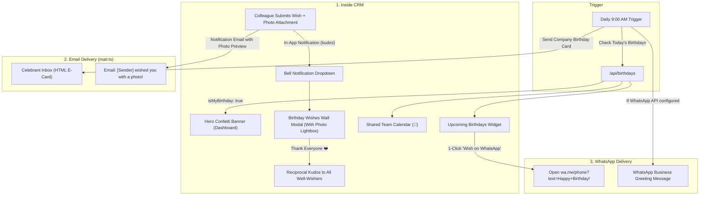

# Implementation Plan: Employee Birthday Wishes Feature & Multi-Channel Delivery

## 1. Overview & Objectives
The **Employee Birthday Wishes** feature fosters positive team culture, employee recognition, and interpersonal connection across NexAce CRM. It leverages existing Date of Birth (`dob`) records in [`User.ts`](file:///d:/Dev%20AI/CRM/NexAce%20CRM/src/models/User.ts) while strictly respecting employee privacy, age confidentiality, timezones, attachments, and mobile responsiveness.

### Key Goals:
1. **Never reveal employee age or birth year**: Display only celebration month and day (e.g. *"Today!"* or *"Oct 24"*).
2. **Rich Media Attachments & Photos**:
   - Enable colleagues to attach **photos, team memories, birthday cards, memes, GIFs, or congratulatory PDFs** to their birthday greetings.
   - Inline preview, thumbnail rendering, image lightbox expand, and 1-click download for celebrants.
3. **Multi-Channel Delivery (CRM + Email + WhatsApp)**:
   - **Inside CRM**: Dashboard Hero Greeting banner with confetti, Received Wishes Wall, In-App Notifications, and Shared Calendar integration.
   - **Email (Company Mail)**: Automated celebratory greeting email to the celebrant at 9:00 AM via [`src/lib/mail.ts`](file:///d:/Dev%20AI/CRM/NexAce%20CRM/src/lib/mail.ts), plus notification alerts with image badges when colleagues send wishes.
   - **WhatsApp**: 1-Click peer wish shortcut (`wa.me`) with pre-filled greetings, plus optional official WhatsApp Business greeting via the CRM Communication Hub.
4. **Personalized Celebrant Experience**: Celebrant enjoys a celebratory hero banner with confetti, receives peer wishes with attached photos in real-time, and can click **"Thank Everyone ❤️"** to send reciprocal kudos.
5. **Timezone & Leap-Year Resilience**: Robust IST/tenant timezone parsing avoiding UTC day shifts, with Feb 29 leap-day fallback to Feb 28 in non-leap years.
6. **Employee Privacy & Opt-Out**: Configurable `showBirthdayOnDashboard` preference allowing employees to opt out if they prefer quiet celebrations.
7. **Strict Mobile Responsiveness & Icon Standards**: Exclusively FontAwesome 6 icons (`<i className="fa-solid fa-..." />`), viewport containment, and touch targets $\ge 40\text{px}$.

---

## 2. Multi-Channel Wish & Delivery Architecture

```
┌─────────────────────────────────────────────────────────────────────────────┐
│                       MULTI-CHANNEL BIRTHDAY DELIVERY                       │
├──────────────────────┬──────────────────────┬───────────────────────────────┤
│    1. Inside CRM     │    2. Email (Mail)   │       3. WhatsApp             │
├──────────────────────┼──────────────────────┼───────────────────────────────┤
│ • Confetti Hero      │ • Automated Morning  │ • 1-Click WhatsApp Shortcut   │
│   Greeting Banner    │   Birthday E-Card to │   (Direct wa.me link with     │
│   on Celebrant's     │   Celebrant at 9 AM  │   pre-filled greeting text)   │
│   Dashboard          │   via src/lib/mail.ts│ • Official WhatsApp           │
│ • Real-time In-App   │ • Instant Email alert│   Business Greeting dispatch  │
│   Notification       │   when a colleague   │   via CRM Communication Hub   │
│ • Wishes Wall with   │   sends a wish with  │   (/dashboard/chat)           │
│   Attached Photos    │   photo preview      │                               │
│ • Shared Calendar 🎂 │                      │                               │
│ • Dashboard Widget   │                      │                               │
└──────────────────────┴──────────────────────┴───────────────────────────────┘
```



---

## 3. Data Model Design

### Model: `BirthdayWish`
File: [`src/models/BirthdayWish.ts`](file:///d:/Dev%20AI/CRM/NexAce%20CRM/src/models/BirthdayWish.ts)

```typescript
import mongoose, { Schema, Document, Model } from "mongoose";

export interface IBirthdayWish extends Document {
  recipientId: mongoose.Types.ObjectId;  // Celebrant
  senderId: mongoose.Types.ObjectId;     // Colleague sending the wish
  senderName: string;
  senderPhotoUrl?: string;
  senderDepartment?: string;
  message: string;
  sticker?: string;                      // E.g. "cake", "balloons", "cheers", "star", "gift"
  attachmentUrl?: string;                // Base64 data URL or uploaded image/document URL
  attachmentName?: string;               // e.g. "team_photo_party.jpg"
  attachmentType?: "image" | "file";     // Attachment classification
  year: number;                          // Celebration year (e.g. 2026)
  acknowledged: boolean;                 // Set to true when celebrant clicks "Thank Everyone"
  tenantId: mongoose.Types.ObjectId;
  createdAt: Date;
  updatedAt: Date;
}

const BirthdayWishSchema = new Schema<IBirthdayWish>(
  {
    recipientId:      { type: Schema.Types.ObjectId, ref: "User", required: true, index: true },
    senderId:         { type: Schema.Types.ObjectId, ref: "User", required: true },
    senderName:       { type: String, required: true, trim: true },
    senderPhotoUrl:   { type: String, default: "" },
    senderDepartment: { type: String, default: "" },
    message:          { type: String, required: true, trim: true, maxlength: 500 },
    sticker:          { type: String, enum: ["cake", "balloons", "cheers", "star", "gift"], default: "cake" },
    attachmentUrl:    { type: String, default: "" },
    attachmentName:   { type: String, default: "" },
    attachmentType:   { type: String, enum: ["image", "file"], default: "image" },
    year:             { type: Number, required: true },
    acknowledged:     { type: Boolean, default: false },
    tenantId:         { type: Schema.Types.ObjectId, ref: "Tenant", required: true, index: true },
  },
  { timestamps: true }
);

// One wish per sender per recipient per calendar year
BirthdayWishSchema.index(
  { tenantId: 1, recipientId: 1, senderId: 1, year: 1 },
  { unique: true }
);

export const BirthdayWish: Model<IBirthdayWish> =
  mongoose.models.BirthdayWish ||
  mongoose.model<IBirthdayWish>("BirthdayWish", BirthdayWishSchema);
```

### User Model Extension: Privacy & Preferences
File: [`src/models/User.ts`](file:///d:/Dev%20AI/CRM/NexAce%20CRM/src/models/User.ts)
```typescript
preferences?: {
  showBirthdayOnDashboard?: boolean; // Default true, allows opting out of public broadcast
}
```

---

## 4. API Specifications & Timezone Logic

### 1. Date & Timezone Alignment Utility
File: `src/lib/birthdays/date-utils.ts`
* Uses Indian Standard Time (`Asia/Kolkata` / UTC+5:30) or tenant locale:
  ```typescript
  export function getLocalDateParts(date: Date, timeZone = "Asia/Kolkata") {
    const formatter = new Intl.DateTimeFormat("en-IN", {
      timeZone,
      month: "numeric",
      day: "numeric",
      year: "numeric"
    });
    const parts = formatter.formatToParts(date);
    return {
      month: parseInt(parts.find(p => p.type === "month")!.value, 10),
      day: parseInt(parts.find(p => p.type === "day")!.value, 10),
      year: parseInt(parts.find(p => p.type === "year")!.value, 10),
    };
  }

  // Leap-Year Fallback: In non-leap year, celebrate Feb 29 on Feb 28
  export function isBirthdayMatch(dob: Date, targetDate: Date, timeZone = "Asia/Kolkata"): boolean {
    const d = getLocalDateParts(dob, timeZone);
    const t = getLocalDateParts(targetDate, timeZone);
    
    // Normal match
    if (d.month === t.month && d.day === t.day) return true;
    
    // Leap-year baby (Feb 29) on non-leap year: celebrate on Feb 28
    const isLeapYear = (t.year % 4 === 0 && t.year % 100 !== 0) || (t.year % 400 === 0);
    if (!isLeapYear && d.month === 2 && d.day === 29 && t.month === 2 && t.day === 28) {
      return true;
    }
    return false;
  }
  ```

### 2. `GET /api/birthdays`
* **Route**: [`src/app/api/birthdays/route.ts`](file:///d:/Dev%20AI/CRM/NexAce%20CRM/src/app/api/birthdays/route.ts)
* **Auth**: `requireTenantSession()`
* **Query Filters**:
  * Must filter `status: "active"` and `tenantId: session.tenantId` (excludes former or suspended staff).
  * Excludes users with `"preferences.showBirthdayOnDashboard": false`.
* **Output Payload**:
  * `today`: List of celebrants today (name, avatar, department, phone, isWeekendCelebration).
  * `upcoming`: Birthdays in next 14 days (with `daysRemaining` countdown pill, e.g. `In 4 days`).
  * `isMyBirthday`: Boolean flag indicating if current logged-in user is celebrating today.
  * `myWishes`: Array of received wishes for current year with attached photos/documents.
  * `wishesSentToday`: Array of `recipientId`s current user has already wished today (disables "Send Wish" button).

### 3. `POST /api/birthdays/wish` (With Attachment Support)
* **Route**: [`src/app/api/birthdays/wish/route.ts`](file:///d:/Dev%20AI/CRM/NexAce%20CRM/src/app/api/birthdays/wish/route.ts)
* **Body**:
  ```typescript
  {
    recipientId: string;
    message: string;
    sticker?: string;
    attachmentUrl?: string;   // Base64 data URL (max 5MB) or uploaded media URL
    attachmentName?: string;  // e.g. "happy_birthday.png"
    attachmentType?: "image" | "file";
  }
  ```
* **Actions**:
  1. Validates recipient is in same tenant and active.
  2. Ensures sender is not wishing themselves.
  3. Enforces date gating (recipient's birthday is today or active weekend celebration).
  4. Saves `BirthdayWish` record with attachments.
  5. Creates an in-app `Notification`:
     - `recipientId`: celebrant ID
     - `type`: `"kudos"`
     - `title`: `attachmentUrl ? "📸 Birthday Wish with Photo from " + senderName : "🎉 Birthday Wish from " + senderName`
     - `message`: `"${message.slice(0, 100)}..."`
     - `linkUrl`: `/dashboard?showWishes=true`
  6. Sends email alert to celebrant using `src/lib/mail.ts` (if enabled in tenant settings), including attachment thumbnail.

### 4. `POST /api/birthdays/thank-all`
* **Route**: [`src/app/api/birthdays/thank-all/route.ts`](file:///d:/Dev%20AI/CRM/NexAce%20CRM/src/app/api/birthdays/thank-all/route.ts)
* **Purpose**: Celebrant 1-click thank you to all colleagues who wished them.
* **Actions**:
  1. Finds all wishes received by current user this year.
  2. Marks `acknowledged = true`.
  3. Sends a notification (`type: "kudos"`) to every well-wisher:
     - Title: `❤️ Thank You from ${celebrant.name}!`
     - Message: `${celebrant.name} says: "Thank you so much for the lovely birthday wishes, photos and celebration!"`

### 5. `GET /api/calendar` (Stream Enhancement)
* **Route**: [`src/app/api/calendar/route.ts`](file:///d:/Dev%20AI/CRM/NexAce%20CRM/src/app/api/calendar/route.ts)
* Dynamically streams active employees' birthdays into the month grid with title `🎂 [Name]'s Birthday` and category styling, omitting birth year/age.

---

## 5. UI Component Specifications

### Component A: `UpcomingBirthdaysWidget.tsx`
* **File**: `src/components/dashboard/UpcomingBirthdaysWidget.tsx`
* **Placements**:
  - [`AdminDashboard.tsx`](file:///d:/Dev%20AI/CRM/NexAce%20CRM/src/components/dashboard/AdminDashboard.tsx)
  - [`HRDashboard.tsx`](file:///d:/Dev%20AI/CRM/NexAce%20CRM/src/components/dashboard/HRDashboard.tsx)
  - [`EmployeeDashboard.tsx`](file:///d:/Dev%20AI/CRM/NexAce%20CRM/src/components/dashboard/EmployeeDashboard.tsx)
* **Features**:
  - **Today's Section**:
    - Festive glowing card with party badges.
    - <i className="fa-solid fa-gift" /> **"Send Wish"** button (opens modal).
    - <i className="fa-brands fa-whatsapp text-emerald-500" /> **"Wish on WhatsApp"** button (instant 1-click deep-link opening WhatsApp with pre-filled greeting).
  - **Upcoming Section (1–14 Days)**:
    - Lists colleagues with countdown badges (`In 2 days`, `This Friday`).
    - Wish button locked with friendly tooltip (`Unlocks on their birthday`) to keep focus on today's celebrants.
  - **Weekend Highlight**: Friday displays "Celebrating this Saturday/Sunday".

### Component B: `BirthdayCelebrationBanner.tsx`
* **File**: `src/components/dashboard/BirthdayCelebrationBanner.tsx`
* **Placement**: Top of dashboard, rendered **only** when `isMyBirthday === true`.
* **Features**:
  - Canvas confetti particle burst on page load.
  - Warm greeting: *"🎉 Happy Birthday, [Name]! Wishing you a fantastic day from the entire team!"*
  - Interactive actions:
    - **"💌 View Received Wishes (Count)"**: Opens wishes wall with all messages & photos.
    - **"Thank Everyone ❤️"**: Triggers `POST /api/birthdays/thank-all` with toast feedback.

### Component C: `SendBirthdayWishModal.tsx` (With Photo & Attachment Upload)
* **File**: `src/components/dashboard/SendBirthdayWishModal.tsx`
* **Features**:
  - **1-Tap Quick Reaction Stickers**:
    - 🎂 Cake & Cheers
    - 🎈 Balloons & Joy
    - 🌟 Star & Success
    - 🥂 Celebration
    - 🎁 Surprise Gift
  - **Preset Wish Pills**:
    - *"Wishing you a fantastic year filled with happiness and success! 🎂"*
    - *"Happy Birthday! Have a wonderful day celebrating! 🎉"*
    - *"May your special day bring you lots of joy and blessings! 🌟"*
  - **Photo & Attachment Dropzone / File Picker**:
    - Supports photos (`image/png`, `image/jpeg`, `image/webp`), animated celebration GIFs, and greeting PDFs (up to 5MB).
    - Image thumbnail preview with 1-click remove `<button type="button" onClick={removeAttachment}><i className="fa-solid fa-xmark" /></button>`.
    - Instant camera snap on mobile (`capture="environment"` or gallery picker).
  - Custom textarea (max 500 characters).
  - Dual action buttons:
    - <i className="fa-solid fa-paper-plane" /> **Send in CRM**
    - <i className="fa-brands fa-whatsapp text-emerald-500" /> **Send via WhatsApp**
  - Mobile constraints: `max-h-[90vh] flex flex-col`, viewport safe insets, fixed header/footer.

### Component D: `BirthdayWishesModal.tsx` (Celebrant Inbox & Photo Gallery)
* **File**: `src/components/dashboard/BirthdayWishesModal.tsx`
* **Features**:
  - Feed of all personal wishes received by the celebrant.
  - Sender avatar, department, timestamp, chosen sticker, and personal message.
  - **Interactive Photo & Media Cards**:
    - Click-to-enlarge **Lightbox** modal for viewing attached photos and team memories in high resolution.
    - 1-click **Download / Save Photo** button (`<i className="fa-solid fa-download" />`).
    - Document attachment chip for congratulatory PDFs.
  - Bottom action bar with **"Thank Everyone ❤️"** reciprocal acknowledgement.

---

## 6. Strict Rule Compliance Checklist

| Rule | Enforcement Strategy |
| :--- | :--- |
| **FontAwesome 6 Icons Only** | All buttons, badges, tabs, and headers strictly use `<i className="fa-solid fa-cake-candles" />`, `<i className="fa-solid fa-gift" />`, `<i className="fa-solid fa-image" />`, `<i className="fa-solid fa-paperclip" />`, `<i className="fa-solid fa-heart" />`, `<i className="fa-brands fa-whatsapp" />`. No Lucide or SVG substitutes. |
| **Mobile Responsiveness** | Modals use `max-h-[90vh] flex flex-col` with `overflow-y-auto overscroll-contain`, fixed header/footer, safe insets (`p-3 sm:p-4`), and tap targets $\ge 40\text{px}$. Attachment dropzone is touch-friendly and scales down smoothly on small screens. |
| **Age Privacy** | Date of Birth calculations parse only Month and Day. Age and Birth Year are strictly omitted from all public API responses, emails, and UI cards. |
| **Tenant Isolation & Status** | Strict MongoDB query matching on `tenantId` and `status: "active"`. Deactivated/former employees are excluded. |

---

## 7. Phased Implementation Roadmap

### Phase 1: Database & API Foundations
- [ ] Create `src/models/BirthdayWish.ts` with `attachmentUrl`, `attachmentName`, and `attachmentType`.
- [ ] Add `preferences.showBirthdayOnDashboard` to `User.ts`.
- [ ] Create date utility with IST timezone handling & Feb 29 leap-year fallback.
- [ ] Build `src/app/api/birthdays/route.ts` with active employee filtering & privacy masking.
- [ ] Build `src/app/api/birthdays/wish/route.ts` with attachment handling, in-app notification & email trigger.
- [ ] Build `src/app/api/birthdays/thank-all/route.ts` for reciprocal celebrations.
- [ ] Enhance `src/app/api/calendar/route.ts` to stream team birthdays.

### Phase 2: UI Components & Dashboard Integration
- [ ] Build `SendBirthdayWishModal.tsx` with preset pills, sticker chips, file/image upload dropzone with preview, CRM send, and WhatsApp deep-link.
- [ ] Build `UpcomingBirthdaysWidget.tsx` with Today / Upcoming tabs, weekend highlights, and countdown pills.
- [ ] Build `BirthdayCelebrationBanner.tsx` and `BirthdayWishesModal.tsx` with image lightbox modal and download actions.
- [ ] Embed the widget across `AdminDashboard.tsx`, `HRDashboard.tsx`, and `EmployeeDashboard.tsx`.

### Phase 3: Mobile Audit & Verification
- [ ] Run `npx tsc --noEmit` to verify type safety and clean compilation.
- [ ] Test photo attachment uploads, previews, and lightbox display across mobile and desktop.
- [ ] Test 1-click WhatsApp deep-link across mobile and desktop.
- [ ] Test email delivery using `src/lib/mail.ts`.
- [ ] Audit tap targets, modal scrolling, and horizontal responsiveness across viewports.
