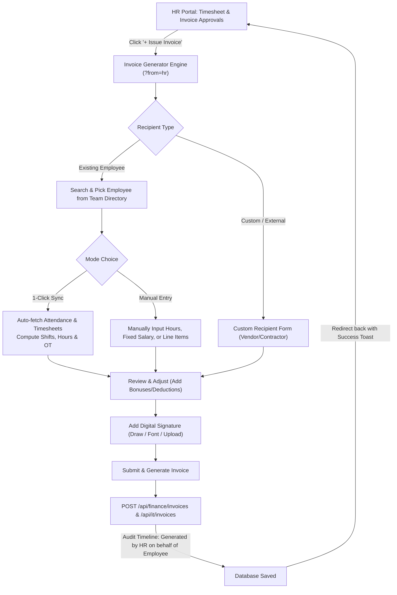

# Implementation Plan: HR Employee & Custom Invoice Generator

## 1. Overview & Objective
Enable HR personnel (along with OPS and Admins) to issue invoices directly from **HR Portal > Timesheet & Invoice Approval**, leveraging the established **Finance Portal invoice generator engine** ([`src/app/dashboard/finance/invoices/new/page.tsx`](file:///d:/Dev%20AI/CRM/NexAce%20CRM/src/app/dashboard/finance/invoices/new/page.tsx)).

The generator will support:
1. **Existing User / Employee Invoice**:
   - **1-Click Sync**: Instant auto-calculation of shifts, regular hours, overtime hours, and logged timesheet tasks from attendance and timesheet databases for the selected billing period.
   - **Manual Mode**: Complete freedom to manually enter or override hours, rates, fixed salary, or add individual adjustments (bonuses, overtime pay, deductions, reimbursements).
2. **Custom Invoice**:
   - Invoicing external contractors, vendors, or custom entities with manual recipient details and dynamic line items.
3. **Seamless HR Workflow**:
   - Accessible directly via an **"Issue Invoice"** action in **HR Portal > Timesheet & Invoice Approvals**.
   - Context-aware return routing back to the HR approvals table (`?from=hr`).
   - Immediate timeline audit logging and status routing (`Approved by HR` / `Pending Settlement` or `Pending`).

---

## 2. Architecture & Workflow Design



---

## 3. Step-by-Step Implementation Roadmap

### Phase 1: Entry Point & Permission Access in HR Portal
1. **Button Placement in [`AdminInvoicesTab.tsx`](file:///d:/Dev%20AI/CRM/NexAce%20CRM/src/components/settings/AdminInvoicesTab.tsx)**:
   - Add a high-visibility action button:
     ```tsx
     <Button
       onClick={() => router.push("/dashboard/finance/invoices/new?from=hr")}
       className="gap-2 h-8 font-bold bg-primary text-primary-foreground hover:bg-primary/90 shadow-xs cursor-pointer"
     >
       <i className="fa-solid fa-file-invoice-dollar text-xs" />
       <span>Issue Invoice</span>
     </Button>
     ```
   - Positioned in the header next to Sort and Refresh buttons, visible when the user is `HR`, `Admin`, `isOPS`, or has `can("approveTimesheetsAndInvoices")` / `can("createInvoices")`.
2. **Permission Guard Check in [`invoices/new/page.tsx`](file:///d:/Dev%20AI/CRM/NexAce%20CRM/src/app/dashboard/finance/invoices/new/page.tsx)**:
   - Ensure HR role (`user?.role === "HR" || can("approveTimesheetsAndInvoices")`) is explicitly authorized to access the generator page without any redirect kickback.
   - Read `const fromSource = searchParams.get("from");` (e.g. `"hr"`).
   - If `fromSource === "hr"`, set breadcrumbs and Back button to return to `/dashboard/hr?tab=invoices`, and on save redirect back to `/dashboard/hr?tab=invoices`.

---

### Phase 2: Attendance & Timesheet 1-Click Sync Backend Support
1. **Attendance Query by User**:
   - In [`src/app/api/attendance/route.ts`](file:///d:/Dev%20AI/CRM/NexAce%20CRM/src/app/api/attendance/route.ts), ensure privileged roles (`HR`, `Admin`, `OPS`) can supply `?userId=<id>` to directly fetch attendance history for the selected employee within a date range (`?startDate=...&endDate=...` or `?limit=all`).
2. **Timesheets Query by User**:
   - [`src/app/api/timesheets/route.ts`](file:///d:/Dev%20AI/CRM/NexAce%20CRM/src/app/api/timesheets/route.ts) already supports `?userId=<id>&start=<startDate>&end=<endDate>` for elevated roles (`HR`, `Admin`, `OPS`).

---

### Phase 3: Enhancing the Invoice Generator (`invoices/new/page.tsx`)
Extend [`src/app/dashboard/finance/invoices/new/page.tsx`](file:///d:/Dev%20AI/CRM/NexAce%20CRM/src/app/dashboard/finance/invoices/new/page.tsx) with the dual **1-Click Sync** and **Manual** capabilities:

1. **Billing Period Selector**:
   - Provide a month/period picker (`YYYY-MM`) with auto-calculated start and end dates of the billing cycle (e.g. `2026-10-01` to `2026-10-31`).
2. **1-Click Sync Button & State**:
   - When an existing internal employee is selected, render a dedicated **Attendance & Timesheet Sync Card**:
     - **Button**: `<Button onClick={handleSyncAttendanceAndTimesheet} disabled={isSyncing}><i className="fa-solid fa-arrows-rotate" /> 1-Click Sync Attendance & Timesheets</Button>`
     - When clicked, fetches `/api/attendance?userId=${emp._id}&limit=all` and `/api/timesheets?userId=${emp._id}&start=${start}&end=${end}`.
     - Calculates:
       - Total shift hours (regular + overtime).
       - Total days worked.
       - Overtime hours.
       - Timesheet project names and task count.
     - Automatically updates `hoursWorked`, `overtimeHours`, `daysWorked`, and suggests line items or total amount based on the employee's hourly rate or base salary.
     - Displays a green verified summary badge:
       > *"Verified: 168.0 hrs logged across 21 shifts (12.5 hrs overtime) in October 2026."*
3. **Manual Entry Mode**:
   - Provide a seamless toggle or editable fields:
     - Allows HR to manually edit `hoursWorked`, `hourlyRate`, or `fixedAmount`.
     - Allows HR to enter manual overrides with reason notes.
     - Quick-add buttons for standard compensation adjustments:
       - **Overtime Pay**
       - **Performance / Project Bonus**
       - **Expense Reimbursement**
       - **Unpaid Leave / Advance Deduction**
4. **Structured Shift & Timesheet Payload Attachment**:
   - When saving the invoice, attach the structured `shiftAttendance` and `timesheetEntries` metadata to the invoice document in MongoDB so that Admins, HR, and Finance can view the detailed breakdown in `InvoiceDetailsView`.

---

### Phase 4: Approval Status & Timeline Integration
1. **Submission Stage Selection**:
   - If initiated by HR, provide a radio / toggle option:
     - **"Mark Approved by HR (Direct to Admin for Settlement)"** *(Recommended default for HR)*:
       - Sets `status: "Approved"`, `approvalStage: "PENDING_ADMIN"`, and records `hrReview: { reviewedBy: hrUser.name, reviewedAt: new Date() }`.
     - **"Save as Pending Review"**:
       - Standard flow (`status: "Pending"`, `approvalStage: "PENDING_HR"`).
     - **"Save as Draft"**:
       - Stays as draft for further editing.
2. **Timeline Logging**:
   - Adds an entry to `timeline`:
     ```json
     {
       "stage": "HR_GENERATED",
       "status": "Approved",
       "actorName": "HR User Name",
       "actorRole": "HR",
       "note": "Invoice generated and verified by HR on behalf of [Employee Name]. Synchronized shift hours attached.",
       "timestamp": "2026-10-22T..."
     }
     ```

---

## 4. UI/UX & Responsive Guidelines Compliance
- **FontAwesome 6 Only**: Strictly use `<i className="fa-solid fa-..." />` for all buttons, badges, status indicators, and tabs.
- **Mobile Responsiveness**:
  - Grid collapsing (`grid-cols-1 lg:grid-cols-12`).
  - Minimum touch target sizing (`min-h-[38px] sm:min-h-[40px]`).
  - Responsive text and overflow handling (`truncate`, `break-words`).
- **Immediate Feedback**:
  - Non-blocking toast notifications upon successful invoice creation.
  - Clear error states if employee has no bank details or hours logged.

---

## 5. Verification Checklist

| Step | Action | Expected Result |
| :--- | :--- | :--- |
| 1 | Navigate to **HR Portal > Timesheet & Invoice Approval** | "Issue Invoice" button is clearly visible in the toolbar. |
| 2 | Click "Issue Invoice" | Navigates to invoice generator with `?from=hr` breadcrumbs and Back link. |
| 3 | Select **Internal Team** and pick an employee | Employee details, salary, and banking details are pre-filled. |
| 4 | Click **1-Click Sync Attendance & Timesheets** | Fetches shifts & timesheets, auto-calculates hours, and displays summary badge. |
| 5 | Toggle to **Manual Mode** / Edit fields | User can freely adjust hours, rates, and add bonuses or deductions. |
| 6 | Select **Custom Invoice** mode | Can invoice external vendors/contractors with dynamic custom line items. |
| 7 | Submit invoice | Saves invoice to DB with HR timeline attribution and redirects back to HR Approvals queue. |
